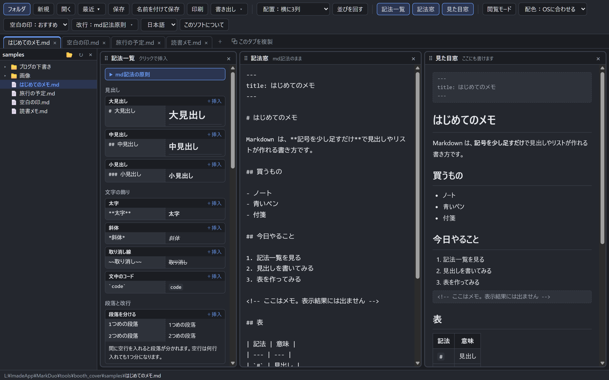

# MarkDuo

**A Markdown editor for complete beginners. Learn Markdown while you write.**

Type in the Markdown pane (raw Markdown) or the Result pane (how it looks), and the other one follows.
Keep the cheat sheet and "Markdown basics" beside you and learn the syntax as you go.

[日本語の説明は下にあります](#日本語)

## Download

- **[Download the latest version](https://github.com/Denkikaiden/MarkDuo/releases/latest)** (zip: app installer + browser version)
- Try the browser version without downloading: https://app.den3dcg.com/markduo/

## Features

- Write in either pane. What you type in the Result pane stays exactly as typed; headings and lists are written in the Markdown pane, so you learn the syntax
- Cheat sheet: click "+ Insert" to put the syntax at the cursor
- Markdown basics: the rules for blank lines, line breaks and spaces, and why
- Protected blocks: front matter, comments and HTML tags are kept when you edit in the Result pane
- Images (URL and relative paths), print, export (HTML file, copy HTML, PDF)
- Read mode, space marks, line-break mode (GitHub style / as typed)
- Light and dark themes. Japanese and English interface

The app version also has tabs, an explorer for a folder of .md files, recent files, opening .md files by double-click, and restores your tabs with unsaved text.

## Two versions

| | Browser version | App version |
| --- | --- | --- |
| File | `MarkDuo.html` | `MarkDuo_(version)_x64-setup.exe` |
| Install | Not needed. Open it in Chrome or Edge | Windows 10 / 11 (64-bit) |
| Tabs, explorer, recent files | – | Yes |
| Images next to the .md file | Asks for folder permission each time | No prompt |

## Installing the app version

1. Unzip the file and double-click `MarkDuo_(version)_x64-setup.exe` (administrator rights are not needed).
2. If "Windows protected your PC" appears, click "More info" and then "Run anyway" (the app is not digitally signed).
3. Follow the instructions on the screen.

The app needs the Microsoft Edge WebView2 Runtime, which is normally included in Windows 10 / 11.

## Terms of use

- MarkDuo is freeware. It is free to use.
- You may redistribute the zip for free as long as you do not change its contents.
- The author is not responsible for any damage caused by using this software.
- The libraries used and their licenses are listed in `ライセンス.txt` in the zip.

## Contact

- X: https://x.com/denkikaiden
- Bluesky: https://bsky.app/profile/denkikaiden.com
- BOOTH: https://denkikaiden.booth.pm/items/9183593

---

## 日本語

**初心者が Markdown 記法をゼロから学びつつ、実作業にそのまま使えるエディターです。**

記法窓（md記法のまま）と見た目窓（表示結果）の、どちらに書いても、もう片方に反映されます。
記法一覧と「md記法の原則」を横に置いて、覚えながら書けます。

### ダウンロード

- **[最新版をダウンロード](https://github.com/Denkikaiden/MarkDuo/releases/latest)**（zip：アプリ版のインストーラーとブラウザ版）
- ブラウザ版は、ダウンロードしなくても試せます：https://app.den3dcg.com/markduo/
- BOOTH でも配っています（中身は同じです）：https://denkikaiden.booth.pm/items/9183593

### できること

- 記法窓と見た目窓の、どちらに書いても反映されます。見た目窓に書いたものは、書いたとおりの文字で残ります。見出しやリストは記法窓で書くので、書きながら記法が身に付きます
- 記法一覧：「＋挿入」で、カーソルの位置に記法が入ります
- md記法の原則：空行・改行・空白などの決まりと、その理由
- 保護ブロック：設定情報・`<!-- メモ -->`・HTML のタグを、見た目窓で編集しても消さずに残します
- 画像の表示（URL・相対パス）、印刷、書き出し（HTML ファイル・HTML をコピー・PDF）
- 閲覧モード、空白の印、改行の扱いの切り替え
- 配色（ライト・ダーク）、日本語と英語

アプリ版では、タブ・エクスプローラー窓・最近使ったファイル・.md のダブルクリックで開く・書きかけのタブの復元もできます。

### アプリ版のインストール

1. zip を展開し、`MarkDuo_(バージョン番号)_x64-setup.exe` をダブルクリックします（管理者の権限は必要ありません）。
2. 「Windows によって PC が保護されました」と出たら、「詳細情報」→「実行」を押します（電子署名をしていないために出る表示です）。
3. 画面の案内どおりに進めます。

くわしい使い方は、zip の中の `はじめにお読みください.txt` にあります。

### ご利用について

- フリーウェアです。無料で使えます。
- zip の中身を変えずに無料で配るのであれば、再配布は自由です。
- このソフトを使ったことで起きた損害について、作者は責任を負いません。

### 連絡先

でん⚡きかいでん
- X：https://x.com/denkikaiden
- Bluesky：https://bsky.app/profile/denkikaiden.com
- 伝言板：https://bbs.denkikaiden.com/
